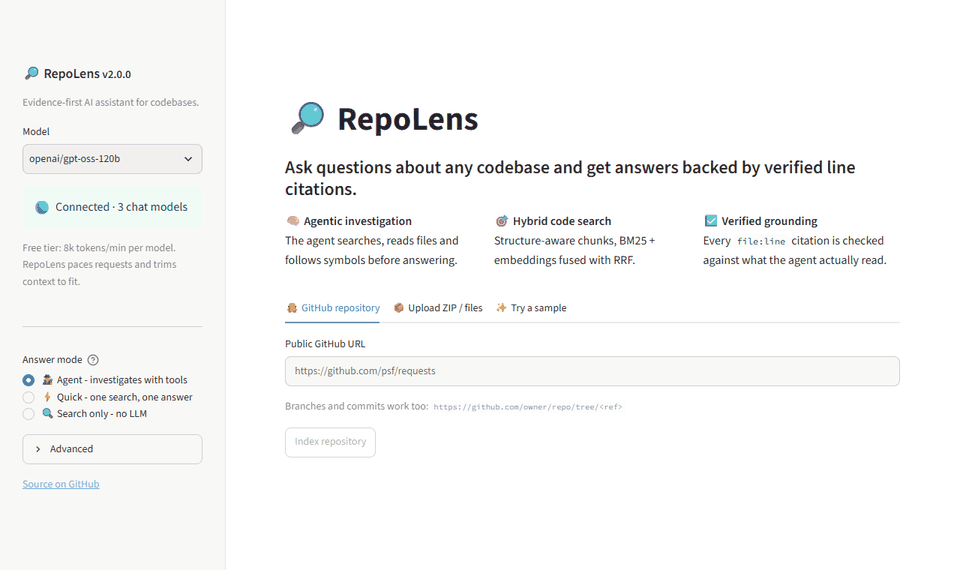
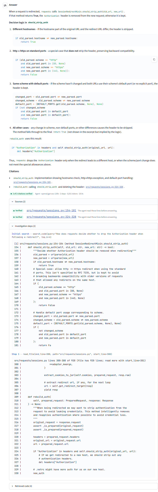
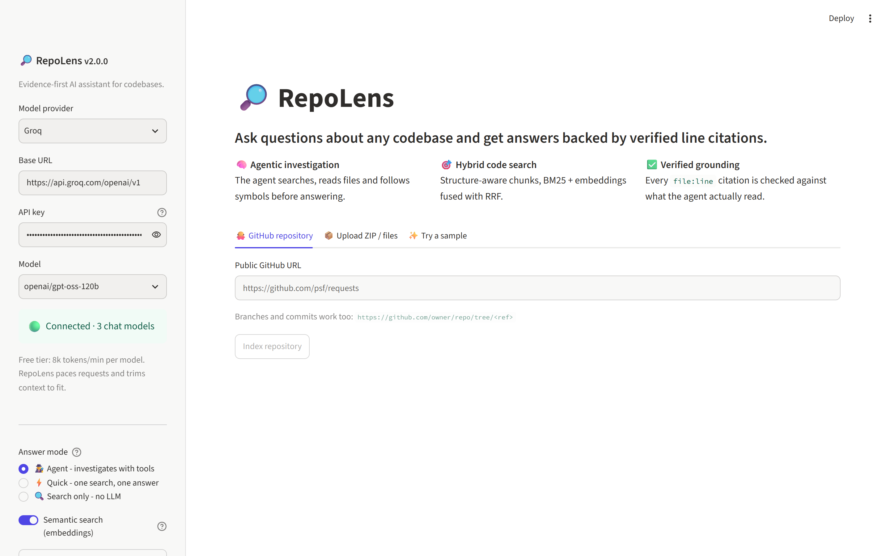
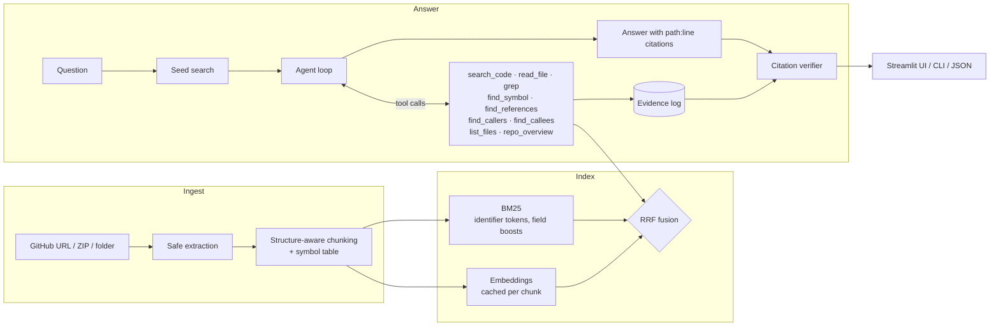

# 🔎 RepoLens

**An evidence-first AI agent for understanding codebases.** Point it at a repository, ask a question in plain English, and RepoLens investigates the code with tools (search, read, grep, go-to-definition, find-references) before answering. Every `file:line` citation in the answer is then **checked against the code the agent actually read**, so hallucinated references are caught instead of shown to you as facts.

[](https://github.com/Max0786234/RepoLens/actions/workflows/ci.yml)


<p align="center">
  
  <br><sub>A real session (public-demo mode, gpt-oss-120b on Groq): pick a repository, ask a question, get an answer whose citations are verified against the code and linked to GitHub.</sub>
</p>

### [**Try the live demo →** repolensapp.streamlit.app](https://repolensapp.streamlit.app/)

Runs on Streamlit Community Cloud with a free Groq model (8 AI answers per session; [how it is deployed](docs/DEPLOY.md)). Running it locally takes two minutes — see [Quick start](#quick-start).

```text
$ repolens ask https://github.com/psf/requests "How does requests decide whether to drop the Authorization header on a redirect?"

  -> [auto] search_code(query="How does requests decide whether to drop the Authorization header...", top_k=4)

Requests decides whether to drop the Authorization header when following a redirect by evaluating
the redirect's origin and destination URLs using the `should_strip_auth` method in
`src/requests/sessions.py`.

The method checks if the hostname of the old URL (the original request) differs from the hostname
of the new URL (the redirect destination). If the hostnames are different, it returns `True`,
meaning the Authorization header should be stripped. This prevents credential leakage when
redirecting to a different domain.

Additionally, there is a special case for HTTP-to-HTTPS redirects when using standard ports ...
This logic is defined in `src/requests/sessions.py:154-184` ...

Grounding: 1/1 citations verified
  [ok] src/requests/sessions.py:154-184
```

<sub>Real output from `qwen3:4b-instruct` running locally on a CPU-only laptop via Ollama (abridged).</sub>

<details><summary><b>More screenshots</b></summary>

An answer about <code>psf/requests</code> from <code>gpt-oss-120b</code> on Groq — every citation is verified against the code the agent read and links to the exact lines on GitHub:



Start screen — load a GitHub repository, an upload or a sample:



</details>

---

## Why this project

Developers spend more time *finding* the right code than changing it. LLMs can help, but they confidently cite files and functions that do not exist. RepoLens is built around three ideas:

1. **Retrieval quality matters more than model size.** Structure-aware chunking and hybrid search let a 4B-parameter local model answer real questions about real repositories.
2. **Agents should investigate, not guess.** The model gets read-only tools and a step budget, and must gather evidence before answering.
3. **Grounding should be measured, not promised.** Citations are verified against an evidence log, and the whole pipeline is benchmarked on labelled questions against the original v1 implementation.

## Features

- **A conversation, not a search box** — ask follow-ups ("are there tests for it?", "what calls that?"): RepoLens keeps the topic for retrieval and remembers which code it already examined, in the web app and in `repolens chat`.
- **Agentic investigation** — a tool-calling loop with 9 sandboxed, read-only tools (including call-graph navigation: who calls X, what X calls), seeded retrieval, duplicate-call protection and a budget-aware final answer.
- **Citation verification** — each citation is classified ✅ verified (the agent read those lines), ⚠️ unverified (exists but was never inspected) or ❌ invalid (file/lines do not exist).
- **Hybrid code search** — BM25 with identifier-aware tokenisation and field boosts, plus embeddings, fused with Reciprocal Rank Fusion.
- **Structure-aware chunking** — functions, classes and methods via Python's `ast`, definition detection for JS/TS, Go, Rust, Java/Kotlin/C#/Swift, C/C++, Ruby and PHP, heading-based Markdown sections; also produces a symbol table.
- **Any source** — public GitHub URL (branch/commit aware, no `git` needed), ZIP or file upload, local folder; extraction is zip-slip and zip-bomb safe.
- **Local-first, provider-agnostic** — runs fully offline with Ollama; any OpenAI-compatible API (OpenAI, Groq, Anthropic, OpenRouter, vLLM, …) is a configuration change.
- **Fast after the first run** — the index is persisted and reused until files change; embeddings are cached per chunk, so editing one file re-embeds only its chunks.
- **Three ways to use it** — Streamlit web app, a CLI with JSON output, and a Python API.

## Architecture



**How a question is answered (agent mode):**

1. **Seed** — hybrid search runs on the question *before* the model's first turn, so even small models start from evidence.
2. **Investigate** — the model calls tools (up to a step budget). Errors are returned as text the model can recover from; repeated identical calls are short-circuited.
3. **Answer** — when the model stops calling tools (or the budget is exhausted) it answers from the gathered evidence with `path:start-end` citations.
4. **Verify** — citations are parsed and checked against every line range the tools showed the model.

**Quick mode** does one retrieval and one streamed answer — much faster on CPU-only machines. **Search mode** needs no LLM at all.

## Benchmark

RepoLens ships with a reproducible benchmark: **52 hand-labelled questions** over three popular repositories pinned to exact commits — [psf/requests](https://github.com/psf/requests), [pallets/flask](https://github.com/pallets/flask) and [expressjs/express](https://github.com/expressjs/express) (JavaScript). Each question has the file and line range that answers it. Questions are tagged *identifier* (names the function) or *natural* (paraphrased, no identifier given), and the **original v1 retriever is kept as a baseline**.

### Retrieval

| Method | File Hit@1 | File Hit@5 | MRR@10 | Span Hit@5 | Span Hit@5 (paraphrased) |
|---|---|---|---|---|---|
| v1 baseline (45-line windows + BM25) | 0.61 | 0.86 | 0.72 | 0.71 | 0.71 |
| v2 BM25 (code-aware) | 0.79 | 0.94 | 0.84 | 0.89 | 0.86 |
| v2 vector (`embeddinggemma`) | 0.64 | 0.92 | 0.77 | 0.89 | 0.86 |
| **v2 hybrid (BM25 + vector, RRF)** | **0.79** | **1.00** | **0.87** | **0.94** | **0.93** |

On *identifier* questions every v2 method scores Span Hit@5 = 1.00 (v1: 0.70); the hybrid's advantage comes from paraphrased questions, where neither keywords nor embeddings alone are enough. v2 BM25 answers a query in **4 ms** vs 128 ms for v1 (which re-chunked the repository on every query); vector and hybrid search add one query embedding (≈5 s on the CPU-only test laptop through Ollama, milliseconds on a GPU or hosted API, cached per query).

*Span Hit@5: a top-5 result overlaps the exact lines that answer the question. File Hit@k: a result from a correct file in the top k. MRR@10: mean reciprocal rank of the first result from a correct file.*

### End-to-end answers

9 questions (the first 3 of each repository), answered end to end and scored automatically:

| Setup | Correct verified citation | Grounding | Invalid (hallucinated) citations | Avg tool steps | Avg time | Avg tokens |
|---|---|---|---|---|---|---|
| Quick mode · `qwen3:4b-instruct` · local CPU laptop | 0.78 | 0.78 | **0** | 1.0 | 331 s | – |
| **Agent** · `qwen3:4b-instruct` · local CPU laptop | **1.00** | **1.00** | **0** | 1.0 | 164 s | – |
| **Agent** · `openai/gpt-oss-120b` · Groq free tier | **1.00** | **1.00** | **0** | 3.2 | 90 s | 11k |

- *Correct verified citation*: the answer cites the file that actually answers the question, and the agent was shown those lines. *Grounding*: share of all citations that are verified.
- No answer in any setup cited a file or line that does not exist. The two Quick-mode misses were answers without any line citation.
- Groq times are dominated by deliberate pacing to the free tier's 8k tokens/minute limit, not by the model.

Reproduce: `repolens eval` (retrieval), `repolens eval --skip-retrieval --agent --mode agent --limit 3 [--provider groq]` (answers). Model responses are cached, so a re-run costs no tokens. Raw per-question results, answers and token counts are in [`eval/results/`](eval/results).

## Quick start

**Requirements:** Python 3.10+ and, for answers, [Ollama](https://ollama.com) (or an API key for a hosted provider).

```bash
git clone https://github.com/Max0786234/RepoLens.git
cd RepoLens
python -m venv .venv
source .venv/bin/activate            # Windows: .venv\Scripts\activate
pip install -e ".[app]"

ollama pull qwen3:4b-instruct        # chat model with tool calling
ollama pull embeddinggemma           # embeddings for semantic search (optional)

streamlit run app.py                 # http://localhost:8501
```

No model? Choose **Search only** in the sidebar — retrieval works without any LLM.

### CLI

```bash
repolens index  https://github.com/pallets/flask                 # build + cache the index
repolens search ./my-project "where are JWT tokens validated" --show-code
repolens ask    ./my-project "How does the payment retry logic work?" --trace
repolens ask    ./my-project "Summarise the data model" --mode quick
repolens chat   ./my-project                                      # multi-turn conversation in the terminal
repolens ask    ./my-project "..." --json                         # machine-readable result + trace
```

### Using a hosted model

Any OpenAI-compatible endpoint works. The quickest is Groq's free tier: put your key in a `.env` file (git-ignored) and pick the preset.

```bash
echo "GROQ_API_KEY=gsk_..." > .env
repolens ask ./my-project "How is caching implemented?" --provider groq
REPOLENS_PROVIDER=groq streamlit run app.py      # or choose "Groq" in the sidebar
```

RepoLens is built to live within free-tier limits: it paces requests from the provider's rate-limit headers, retries 429s after `retry-after`, keeps every request inside a token budget (older tool output is trimmed), uses `reasoning_effort=low` for gpt-oss models, and stops investigating when the model starts repeating itself. Other providers:

```bash
export REPOLENS_LLM_BASE_URL=https://api.openai.com/v1   # any OpenAI-compatible server
export REPOLENS_LLM_MODEL=gpt-4.1-mini
export REPOLENS_LLM_API_KEY=...
export REPOLENS_EMBED_BACKEND=none   # hosted chat without local Ollama: BM25 only, or sentence-transformers
```

### Docker

```bash
docker compose up -d                                            # RepoLens + Ollama
docker compose exec ollama ollama pull qwen3:4b-instruct
docker compose exec ollama ollama pull embeddinggemma
```

## Python API

```python
from repolens.config import Settings
from repolens.workspace import open_workspace
from repolens.agent import Agent
from repolens.llm import client_from_settings

settings = Settings.from_env()
ws = open_workspace("https://github.com/psf/requests", settings)
result = Agent(ws.index, client_from_settings(settings), label=ws.source.label).ask(
    "Where are connection retries configured?"
)
print(result.answer)
print(result.grounding.label)  # e.g. "2/2 citations verified"
```

## Design decisions

| Decision | Why |
|---|---|
| Seed the agent with a search before its first turn | Small local models often skip tool use; starting from evidence makes answers grounded even when they do. |
| Verify citations against an evidence log | Turns "grounded answers" into a number you can see on every response and measure in the benchmark. |
| Chunk by definitions, not fixed windows | Fixed windows split functions in half; definition chunks carry a symbol name that both BM25 and the agent use. |
| BM25 + embeddings with RRF | Lexical search nails identifiers, embeddings handle paraphrases; RRF fuses ranks without calibrating two unrelated score scales. |
| Native Ollama API | Ollama's OpenAI-compatible endpoint cannot set the context window and silently truncates the start of long conversations — including the system prompt. |
| Tolerate tool calls written as text | Some models (e.g. qwen2.5-coder) emit tool calls as JSON in the message; they are recovered only when the name matches a real tool. |
| No LLM framework | The goal is to show — and control — the mechanics: ~3.8k lines of Python, one runtime dependency (`numpy`). |
| Follow-up-aware retrieval | "Are there tests for it?" has no searchable terms; follow-ups are searched together with the previous question, and evidence from earlier turns is remembered. |
| Read-only, index-scoped tools | The agent can only read files that are in the index: no secrets (`.env`, keys), no dependencies, nothing outside the repository, no execution. |

## Limitations

- On CPU-only machines local models are slow (an agent answer can take minutes); Quick mode or a hosted model is far faster.
- Non-Python languages use regex-based definition detection, which can miss unusual syntax (tree-sitter would be more precise).
- "Verified" means the agent *saw* the cited lines — it does not prove the claim about them is correct.
- The benchmark is small (52 questions) and was labelled by the author; treat it as a regression suite and a sanity check, not a leaderboard.

## Project layout

```text
repolens/            core package
  agent.py           tool-calling investigation loop
  tools.py           sandboxed tools + evidence log
  citations.py       citation extraction and verification
  index.py           code index: BM25, embeddings, RRF, persistence
  chunking.py        structure-aware chunking and symbols
  ingest.py          GitHub / ZIP / upload ingestion
  llm.py             OpenAI-compatible + native Ollama clients
  rag.py             quick single-shot answers
  conversation.py    follow-up detection + conversation memory
  evaluation.py      benchmark harness  (baseline_v1.py = frozen v1 retriever)
  cli.py             `repolens` command
app.py               Streamlit UI
eval/                benchmark repos, questions and results
tests/               pytest suite (no network or model needed)
```

## Development

```bash
pip install -e ".[dev]"
pytest -q                       # unit + Streamlit AppTest smoke tests
ruff check . && ruff format --check .
```

Deploying your own public demo: see [`docs/DEPLOY.md`](docs/DEPLOY.md).

## License

[MIT](LICENSE)
